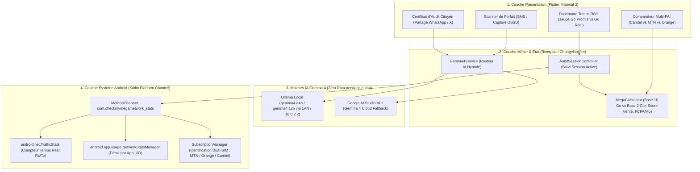

# Dossier de Conception Technique & Architecture
## Projet : **CheckMyMega** — Auditeur de Forfaits Internet propulsé par **Gemma 4**
**Stack officielle :** **Flutter 3.44+ (Dart 3.12)** × **Kotlin Android Natif (`NetworkStatsManager` & `TrafficStats`)** × **Gemma 4 (Ollama Local + Google AI Studio API)**

---

## 1. Architecture Globale de **CheckMyMega**

L'application **CheckMyMega** adopte une architecture **Clean Architecture / MVVM** sous Flutter, couplée à un canal natif Android (`MethodChannel` & `EventChannel`) pour interroger directement les compteurs matériels de données mobiles de l'OS sans aucun intermédiaire réseau.



---

## 2. Conception du Pont Natif Android (`MethodChannel` Kotlin)

### 2.1. Pourquoi `TrafficStats` + `NetworkStatsManager` ?
Pour mesurer la consommation mobile avec une précision chirurgicale au Cameroun (où la majorité des téléphones sont **Dual-SIM**, ex: SIM 1 = MTN/Orange et SIM 2 = Camtel/Blue) :

1. **`TrafficStats.getMobileRxBytes()` & `TrafficStats.getMobileTxBytes()`** :
   - Donne en **temps réel immédiat (milliseconde)** le nombre exact d'octets reçus et envoyés sur l'interface cellulaire depuis le démarrage du téléphone, sans nécessiter de délai de cache.
   - Idéal pour la **jauge en direct** pendant que l'utilisateur navigue.
2. **`NetworkStatsManager.querySummary(ConnectivityManager.TYPE_MOBILE, subscriberId, startTime, endTime)`** :
   - Interroge l'historique système d'Android et retourne la consommation **découpée par application (`uid`)**.
   - Permet de prouver que pendant le test de `1 Go`, l'utilisateur a fait exactement **le même travail** (ex: 400 Mo sur YouTube, 150 Mo sur Chrome) et qu'aucune mise à jour cachée n'a volé ses mégas.

### 2.2. Contrat du `MethodChannel` (`com.checkmymega/network_stats`)

| Méthode appelée depuis Flutter | Arguments | Retour (Kotlin $\rightarrow$ Dart) | Rôle |
| :--- | :--- | :--- | :--- |
| `hasUsageStatsPermission` | Aucun | `bool` | Vérifie si `PACKAGE_USAGE_STATS` est accordée dans Android. |
| `openUsageStatsSettings` | Aucun | `void` | Ouvre directement l'écran système *Accès aux données d'utilisation*. |
| `getMobileCountersSnapshot` | `{startTimeMs, endTimeMs}` | `Map<String, dynamic>` | Retourne `{rxBytes, txBytes, totalBytes, activeOperatorName, networkType}`. |
| `getPerAppMobileUsage` | `{startTimeMs, endTimeMs}` | `List<Map<String, dynamic>>` | Retourne la liste triée des applications `{packageName, appName, uid, rxBytes, txBytes}` ayant consommé de la data pendant la session. |

### 2.3. Permissions dans `android/app/src/main/AndroidManifest.xml`
```xml
<uses-permission android:name="android.permission.INTERNET" />
<uses-permission android:name="android.permission.ACCESS_NETWORK_STATE" />
<uses-permission
    android:name="android.permission.PACKAGE_USAGE_STATS"
    tools:ignore="ProtectedPermissions" />
```

> [!TIP]
> **Mode Simulation / Démo Live (Fallback Multi-plateforme)** :
> Pour que les contributeurs Hacktoberfest (et toi pendant le live sur PC/Émulateur) puissiez tester l'application même sur un émulateur Android sans carte SIM ou sur Windows/Web, le service `NetworkMeterService` inclut un **Simulateur Réseau Réaliste** permettant de rejouer le scénario réel :
> - *Forfait Camtel 1 Go (100 FCFA / 3h)* vs *Forfait MTN 1 Go (500 FCFA)* vs *Forfait Orange 1 Go (500 FCFA)* pour une même charge de travail !

---

## 3. Conception du Double Moteur **Gemma 4** (`GemmaService`)

L'utilisateur ou le contributeur peut basculer en 1 clic dans les paramètres de l'application entre :
1. **Mode Local Ollama (Recommandé — 0 Mo consommé)** :
   - Sur Émulateur Android : `http://10.0.2.2:11434/api/chat`
   - Sur Téléphone physique (Wi-Fi local / USB reverse `adb reverse tcp:11434 tcp:11434`) : `http://127.0.0.1:11434/api/chat`
   - Modèles supportés : `gemma4:e2b`, `gemma4:e4b`, `gemma4:12b`.
2. **Mode Cloud Google AI Studio (Clé API Gemini / Gemma 4)** :
   - Endpoint REST : `https://generativelanguage.googleapis.com/v1beta/models/{model}:generateContent`
   - Idéal pour les contributeurs Hacktoberfest qui n'ont pas de GPU local.

### 3.1. Les 2 Prompts & Schémas JSON de Gemma 4 dans **CheckMyMega**

#### A. Extraction de Forfait (SMS Opérateur / Texte USSD / Image)
Gemma 4 reçoit un SMS brut comme :
- *Camtel* : `"Cher client, votre souscription au forfait Blue Horaire 1Go (100 FCFA) valable 3h a reussi."`
- *MTN* : `"Y'ello! Vous avez active Mobile Surf 1024Mo a 500F valable 24h. Solde: *123*10#"`
- *Orange* : `"Votre forfait Internet 1Go a 500 FCFA est actif pour 24h."`

Et retourne strictement :
```json
{
  "isp": "CAMTEL",
  "planName": "Blue Horaire 1Go",
  "promisedMb": 1024,
  "priceXaf": 100,
  "validityHours": 3,
  "eventType": "ACTIVATION"
}
```

#### B. Diagnostic d'Audit & Verdict Citoyen
À la fin du forfait, Gemma 4 analyse l'écart entre le volume promis et le volume mesuré par le noyau Android :
```json
{
  "verdict": "ANOMALIE_CRITIQUE",
  "veracityScorePct": 62.7,
  "missingMb": 381.9,
  "realCostPerGbXaf": 797,
  "technicalExplanation": "L'interface cellulaire rmnet_data n'a reçu et transmis que 642,1 Mo (Rx: 584 Mo, Tx: 58,1 Mo) avant l'arrêt du forfait de 1024 Mo. La somme des consommations par application correspond au compteur matériel : aucune fuite système en arrière-plan n'explique les 381,9 Mo manquants.",
  "cameroonSummary": "Gars, sur ton 1 Go de 500 FCFA, ton téléphone n'a vraiment vu que 642 Mo ! Il manque 382 Mo à l'appel alors que le 1 Go de Camtel à 100 FCFA a livré 978 Mo pour le même boulot."
}
```

---

## 4. Structure des Dossiers du Projet Flutter (`check_my_mega`)

Le projet sera créé dans `C:\Users\pacco\.gemini\antigravity\scratch\check_my_mega` avec une arborescence claire et prête pour le **Hacktoberfest** :

```text
check_my_mega/
├── android/
│   └── app/src/main/
│       ├── AndroidManifest.xml          # Permissions PACKAGE_USAGE_STATS & Network
│       └── kotlin/.../MainActivity.kt   # Pont Natif NetworkStatsManager & TrafficStats
├── lib/
│   ├── main.dart                        # Point d'entrée + Thème Material 3 (Couleurs Cameroun / Cyber-Audit)
│   ├── models/
│   │   ├── data_plan_session.dart       # Modèle de session d'audit (Camtel, MTN, Orange)
│   │   ├── app_usage_stat.dart          # Consommation par application (UID)
│   │   └── gemma_audit_report.dart      # Rapport généré par Gemma 4
│   ├── services/
│   │   ├── native_network_service.dart  # Communication MethodChannel + Mode Simulation Live
│   │   ├── gemma_service.dart           # Client Hybride Gemma 4 (Ollama Local + Google AI Studio)
│   │   └── storage_service.dart         # Persistance locale des sessions d'audit
│   ├── state/
│   │   └── audit_controller.dart        # Logique métier temps réel, calculs Go/Gio, comparateur
│   └── ui/
│       ├── screens/
│       │   ├── home_audit_screen.dart   # Jauge Temps Réel + Démarrer/Stopper Audit + Détail Apps
│       │   ├── sms_parser_sheet.dart    # Analyseur SMS/USSD propulsé par Gemma 4
│       │   ├── compare_isp_screen.dart  # Comparateur "Même Travail" (Camtel 100F vs MTN 500F vs Orange 500F)
│       │   ├── audit_report_screen.dart # Certificat d'Audit Gemma 4 (Français & Camfranglais)
│       │   └── settings_screen.dart     # Configuration Gemma 4 (Ollama URL / API Key / Permissions OS)
│       └── widgets/
│           ├── mega_gauge_card.dart     # Jauge visuelle Promis vs Réel OS
│           └── isp_badge.dart           # Badges visuels MTN (Jaune), Orange (Orange), Camtel (Bleu)
├── test/
│   └── mega_calculator_test.dart        # Tests unitaires du moteur de calcul d'écart
├── README.md                            # Documentation complète Hacktoberfest + Guide Gemma 4
├── CONTRIBUTING.md                      # Guide de contribution + Idées de PRs Hacktoberfest
└── LICENSE                              # Licence Apache 2.0
```

---

## 5. Formules Mathématiques Intégrées dans `MegaCalculator`

1. **Octets Réels Totaux ($B_{\text{total}}$)** :
   $$B_{\text{total}} = (\text{Rx}_{\text{courant}} - \text{Rx}_{\text{initial}}) + (\text{Tx}_{\text{courant}} - \text{Tx}_{\text{initial}})$$
2. **Double affichage (pour éviter toute excuse du FAI sur le binaire vs décimal)** :
   - **Mégaoctets Commerciaux ($\text{Mo}$, base 10)** : $V_{\text{Mo}} = \frac{B_{\text{total}}}{1\,000\,000}$
   - **Mébioctets Binaires ($\text{Mio}$, base 2)** : $V_{\text{Mio}} = \frac{B_{\text{total}}}{1\,048\,576}$
3. **Taux de Vérité ($\tau$)** :
   $$\tau = \min\left(100, \frac{V_{\text{Mo}}}{V_{\text{promis}}} \times 100\right)$$
4. **Coût Réel de 1 Go Livré ($\text{FCFA / Go Réel}$)** :
   $$\text{Coût Réel} = \frac{\text{Prix du Forfait (FCFA)}}{V_{\text{Mo}} / 1000}$$
